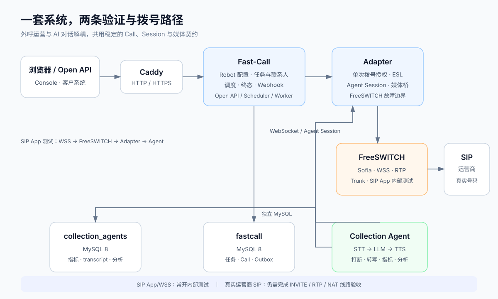

# Fastcall

**一套面向小企业的自部署语音外呼系统：用 Fast-Call 管理外呼运营，用 Collection Agent 完成真实 AI 语音对话；生产只通过运营商 SIP Trunk 外呼，SIP App/WSS 作为常开的内部测试入口。**



## 解决什么问题

| 组件 | 解决的问题 |
|---|---|
| **Fast-Call 控制面** | Robot 配置与不可变版本、联系人加密导入、任务调度、呼叫窗口、并发与速率、禁呼、重试、结果查询和 Webhook 通知 |
| **Fast-Call Adapter** | 单次 originate 授权、FreeSWITCH ESL、Agent Session、双向媒体、通话终态、通道核查与挂断 |
| **Collection Agent** | STT/LLM/TTS 语音交互、打断、无响应、语音信箱，以及通话指标、转写和分析的独立落库 |
| **统一 FreeSWITCH** | 承载正式 Sofia gateway、运营商线路与常开的内部 SIP App/WSS 测试入口 |

Fast-Call 不负责生成 AI 对话，Collection Agent 不管理 Task、Contact、Call 或 SIP。两者通过稳定的 Agent WebSocket 协议协作，并分别使用独立 MySQL 数据库。

## 核心能力

- **任务与外呼闭环**：创建任务、导入联系人、调度拨号、接听、对话、终态、重试和通知。
- **Robot 配置管理**：草稿、校验、发布、精确版本固定和回滚。
- **运营控制**：呼叫时间窗、并发、速率、重试额度、禁呼和任务取消。
- **可追溯**：Call 状态、FreeSWITCH 通道事实、Agent 技术指标、transcript 和 Webhook 投递记录。
- **SIP App/WSS 测试**：使用真实 SIP 注册、ICE/SRTP 和双向 AI 音频验证全链路。
- **统一电话镜像**：FreeSWITCH、Sofia 与 `mod_audio_stream` 固定版本构建。
- **客户集成**：Open API 与带 HMAC、重试和稳定事件 ID 的 HTTPS Webhook。

## Collection Agent：面向真实电话的 Voice Agent 优化

Collection Agent 不只是把 STT、LLM、TTS 三个 API 串起来。它基于 Pipecat 管理完整音频 Pipeline，并针对电话通道中常见的截音、短回答、沉默、语音信箱和挂断不完整做了专门处理。

| 电话场景问题 | 已实现的优化 | 带来的效果 |
|---|---|---|
| 电话音频与模型格式不同 | Standard 使用 8 kHz 单声道电话音频；Realtime 在电话 8 kHz 与 Azure 24 kHz PCM 之间重采样，并统一处理原始音频帧和呼叫事件 | 避免把网页音频假设直接套到电话链路，减少格式错误和不必要的音质损失 |
| 开场慢、第一句话容易被截断 | Standard 的固定欢迎语直接进入 TTS，不等待 LLM 临时生成；欢迎语和固定追询前加入 500 ms 静音前置 | 首句内容确定、响应路径更短，并降低电话媒体刚建立时开头丢音的风险 |
| 用户回答很短，轮次难以判断 | Standard 使用 Silero VAD、基于中间转写的轮次开始和语音超时结束；Vosk 使用更短的语音启动阈值，避免“是/否”一类短回答被漏掉 | 在用户停止说话与尽快回应之间取得平衡，减少等待过长或话未说完就响应 |
| 用户插话不及时，或线路噪声导致误打断 | Standard 与 Realtime 都通过 ASR 转写确认用户轮次，而不是只靠 VAD。Standard 收到首个非空的中间或最终转写即可触发可打断轮次；Realtime alpha 进一步过滤“um / 嗯 / 啊 / 喂”等填充音，用中间转写提前取消当前响应，再由最终转写建立新的用户轮次 | 从“检测到声音”提升为“确认用户在表达内容”，减少误打断，同时让有效插话更快停止机器人说话并得到回应 |
| 用户沉默后通话僵住 | 沉默检测同时考虑用户活动、机器人说话和 LLM 生成状态；按 Robot 配置进行多轮追询，达到次数后播放结束语并按配置挂断 | 避免机器人尚未说完就误判无响应，也避免无人的通话长期占用线路和 Provider 资源 |
| 打到语音信箱仍持续对话 | Standard 根据多语言转写特征检测语音信箱，支持立即挂断、固定留言或原 LLM 留言流程；固定留言可复用严格匹配音色、模型、语言和文本的可缓存留言段，未命中时回退实时 TTS | 减少对自动留言系统的无效对话，固定内容更稳定，缓存命中时无需再次生成该段音频 |
| 结束语没播完就挂断，或资源未释放 | 检测结束语后等待机器人音频停止再挂断，并保留超时兜底；断线、最大通话时长和 Provider 停止均有统一收尾 | 提升结束体验，降低挂断后残留音频任务、WebSocket 或 Provider 连接的风险 |
| 同一次呼叫被重复接管 | Fast-Call Session 使用 Call 与代际 slot，经过 attached/ready ACK 后推进初始化；旧代际和重复 attach 会被拒绝 | 避免重试或重连让同一路电话启动多个 Bot、重复播放或写乱会话状态 |
| 延迟和成本只能凭感觉判断 | Standard 按轮次采集 ASR/LLM/TTS TTFB，并记录实际 Provider/模型、音频时长、重试/重连、token 和估算成本；Realtime 记录融合模型响应、usage 与音频时长。两种模式均保存 transcript 和 Robot 版本 | 能定位慢在识别、模型还是语音合成，并按真实通话数据分析质量和成本 |

此外，Standard 的固定模板文本在送入 TTS 前会完成变量渲染、姓名格式和数字本地化转换，语速、音量、音色和语言由 Robot 配置驱动，减少“金额、年份、电话号码直接逐位读错”一类问题。

**Standard 与 Realtime 的边界：** Standard 是独立的 STT → LLM → TTS 主链路；Azure Realtime 当前仍是 alpha 路径，提供服务端 VAD、可选 RNNoise、基于有效转写的打断确认和流式语音响应。两者共用无响应、语音信箱、优雅挂断、指标与落库能力，但不能把 Realtime 的实验能力视为已经完成生产验收。

## 为什么适合小企业

- **先验证，再接线路**：没有 SIP trunk 也能先验证 Robot、Provider、Agent、数据库和 Webhook。
- **单机即可运行**：Compose 编排服务，不要求 Kubernetes、Kafka 或复杂消息基础设施。
- **复用现有 MySQL**：不强制启动新的数据库容器；Fast-Call 与 Agent 使用两个独立数据库。
- **数据库结构可读**：两个服务各保留一份当前 SQL 快照，没有 Alembic 或隐藏迁移过程。
- **部署边界清楚**：控制面、电话执行和 AI 对话分离，便于定位线路、媒体和 Provider 问题。
- **默认收紧入口**：ESL 不向宿主机发布，使用强密码与 ACL；媒体认证使用 Bearer Header。

## 快速部署

### 1. 准备宿主机依赖

在**部署电脑**准备：

- Docker 与 Docker Compose V2，支持 `docker compose up --wait`。
- Python 3、OpenSSL 命令行工具、MySQL 命令行客户端。
- 一个可连接的 MySQL 8 服务。Compose 不启动 MySQL，也不允许 Agent 使用 SQLite。
- 实际使用的 STT、LLM、TTS Provider 凭据。首验建议固定使用 Deepgram、Deepseek、Cartesia。

先执行自检，任何一项不存在都应先安装：

```bash
docker compose version
python3 --version
openssl version
mysql --version
```

Collection Agent 默认随 Compose 自动构建，也可以使用宿主机上运行的外部 Agent。内部 Agent 固定构建为 `linux/amd64`，以复用现有 RNNoise 的 x86_64 依赖；Apple Silicon 等 ARM Docker 主机需要通过 Docker emulation 运行，外部 Agent 不受此限制。

### 2. 创建数据库、用户并导入 SQL

以下示例假设 MySQL 运行在部署电脑的 `127.0.0.1:3306`。先用 root 登录：

```bash
mysql -h 127.0.0.1 -u root -p
```

在 MySQL 提示符中执行。把两个示例密码替换为不同的强密码：

```sql
CREATE DATABASE fastcall CHARACTER SET utf8mb4 COLLATE utf8mb4_unicode_ci;
CREATE DATABASE collection_agents CHARACTER SET utf8mb4 COLLATE utf8mb4_unicode_ci;

CREATE USER 'fastcall'@'localhost' IDENTIFIED BY '<fastcall数据库密码>';
CREATE USER 'fastcall'@'%' IDENTIFIED BY '<fastcall数据库密码>';
GRANT ALL PRIVILEGES ON fastcall.* TO 'fastcall'@'localhost';
GRANT ALL PRIVILEGES ON fastcall.* TO 'fastcall'@'%';

CREATE USER 'agent'@'localhost' IDENTIFIED BY '<agent数据库密码>';
CREATE USER 'agent'@'%' IDENTIFIED BY '<agent数据库密码>';
GRANT ALL PRIVILEGES ON collection_agents.* TO 'agent'@'localhost';
GRANT ALL PRIVILEGES ON collection_agents.* TO 'agent'@'%';
FLUSH PRIVILEGES;
```

`localhost` 用于宿主机导入 SQL，`%` 用于示例中的容器连接。生产环境应把 `%` 收紧到实际 Docker/LAN 来源，并确认 MySQL `bind-address` 允许容器访问；不要仅为图方便把 MySQL 暴露到公网。

然后在**项目根目录的宿主机终端**导入：

```bash
mysql -h 127.0.0.1 -u fastcall -p fastcall < deploy/mysql/fastcall_current_schema.sql
mysql -h 127.0.0.1 -u agent -p collection_agents < deploy/mysql/agent_current_schema.sql
```

项目只维护当前 SQL 快照，不提供旧库自动升级。只有全新空库执行上述导入；既有数据库应先备份，再确认其结构与当前快照一致。

### 3. 填写部署配置

```bash
cp deploy/compose.env.example deploy/.env.compose
```

编辑 `deploy/.env.compose`：

- 分别设置 `FASTCALL_DATABASE_URL` 和 `AGENT_DATABASE_URL`，不能使用同一个数据库。
- 默认内部 Agent 会随启动器自动构建，`COLLECTION_AGENT_IMAGE` 只需作为镜像标签；或者设置 `FASTCALL_AGENT_EXTERNAL=true`，使用宿主机 Agent。
- 配置实际 Provider 密钥。
- 外部 Agent 必须与 Compose 使用相同的 `FASTCALL_AGENT_TOKEN`。
- 生产保持 `APP_ENV=prod`、`FASTCALL_SIP_ENABLED=true` 和 `FREESWITCH_DIAL_MODE=gateway`，并填写运营商 `FREESWITCH_SIP_GATEWAY`、`FREESWITCH_SIP_HOST` 与实际 `FREESWITCH_EXTERNAL_IP`；缺少任一 Trunk 配置都会拒绝启动。
- 构建 FreeSWITCH 前在终端设置 `SIGNALWIRE_TOKEN`，Compose 仅将它作为 BuildKit secret 使用；不要写入 `.env.compose`、Dockerfile 或服务环境。
- 单个内部测试账号可用 `FREESWITCH_LOCAL_USER` 修改，`FREESWITCH_LOCAL_PASSWORD` 留空即可自动生成强密码。它只用于 WSS/App 测试，不参与生产 originate 路由。

### 4. 启动

```bash
./scripts/bootstrap_compose.sh
```

启动器生成缺失的凭据、Console 证书和带正确 SAN 的 WSS 证书，并启动 Compose。首次生成的 Console 与 SIP 密码会打印，后续重启复用已保存的凭据和证书。启动完成后还会输出 SIP 注册域、WSS 地址和联系人号码。

Console 用户名为 `admin`。如果忘记复制首次随机密码，在宿主机项目根目录执行 `FASTCALL_CONSOLE_ADMIN_PASSWORD='<新的强密码>' ./scripts/bootstrap_compose.sh` 重设；`.env.compose` 中只有哈希，不能找回原明文密码。

本机访问：

```text
http://localhost:8080/console/
```

HTTPS 地址为 `https://fastcall.internal:8443/console/`。本机使用前需在 hosts 文件中添加 `127.0.0.1 fastcall.internal`，并可选择信任 `deploy/runtime/tls/ca.crt` 作为本地 CA。`deploy/runtime/` 和 `deploy/.env.compose` 均已被 Git 忽略。

## 配置文件与环境变量

### 配置文件职责

| 文件或目录 | 用途 |
|---|---|
| `deploy/compose.yaml` | Compose 服务、镜像、网络、端口、健康检查和持久卷；通常不需要修改 |
| `deploy/compose.env.example` | 最小部署配置模板，只包含占位值，可提交到仓库 |
| `deploy/.env.compose` | 实际部署配置和启动器生成的凭据；由模板复制而来，已被 Git 忽略 |
| `deploy/mysql/fastcall_current_schema.sql` | Fast-Call 当前 MySQL 数据库结构 |
| `deploy/mysql/agent_current_schema.sql` | Collection Agent 当前 MySQL 数据库结构 |
| `deploy/caddy/Caddyfile` | Console HTTP/HTTPS 反向代理 |
| `deploy/freeswitch/` | 统一 FreeSWITCH 镜像的构建文件、Sofia/媒体配置及启动模板 |
| `deploy/runtime/` | 启动器生成的内部 TLS 证书和私钥，已被 Git 忽略 |
| 根目录 `.env` | 本地或独立进程运行的配置；Compose 启动时也可作为补充来源，但不是首选配置入口 |

启动器按“进程环境变量 > `deploy/.env.compose` > 根目录 `.env`”读取配置，补全默认值和缺失凭据后，将 Compose 实际使用的完整配置写回 `deploy/.env.compose`。

### 最小配置示例

将 `deploy/compose.env.example` 复制为 `deploy/.env.compose` 后，至少确认以下配置。密码和密钥请替换为实际值，不要直接使用占位文本：

```dotenv
FASTCALL_DATABASE_URL=mysql+pymysql://fastcall:<password>@host.docker.internal:3306/fastcall
AGENT_DATABASE_URL=mysql+pymysql://agent:<password>@host.docker.internal:3306/collection_agents

COLLECTION_AGENT_IMAGE=collection-agent:stable
FASTCALL_AGENT_EXTERNAL=false

APP_ENV=prod
FASTCALL_SIP_ENABLED=true
FREESWITCH_DIAL_MODE=gateway
FREESWITCH_SIP_GATEWAY=<运营商gateway名称>
FREESWITCH_SIP_HOST=<运营商地址>
FREESWITCH_SIP_REGISTER=false
FREESWITCH_EXTERNAL_IP=<运营商可见的本机地址>

# 常开的单个内部测试账号，不参与生产被叫路由。
FREESWITCH_DOMAIN=
FREESWITCH_LOCAL_USER=8615908280801
FREESWITCH_LOCAL_PASSWORD=
FREESWITCH_WSS_PORT=7443

# 首验默认 Robot 使用以下三个 Provider。
DEEPGRAM_API_KEY=<deepgram-key>
DEEPSEEK_API_KEY=<deepseek-key>
CARTESIA_API_KEY=<cartesia-key>
```

数据库密码如果包含 `@`、`:`、`/`、`#`、`%`、`&`、`=`、`+` 等字符，先做 URL 编码再填入连接串，可执行 `python3 -c 'from urllib.parse import quote_plus; print(quote_plus("你的数据库密码"))'` 获取编码结果。

使用宿主机 Agent 时改为 `FASTCALL_AGENT_EXTERNAL=true`，并确保 Agent 已连接 `AGENT_DATABASE_URL` 指向的数据库。首次启动可让启动器生成 Console 密码；后续重启会复用已保存的登录凭据。

### 重要环境变量

**基础运行与镜像**

| 变量 | 默认值或要求 | 说明 |
|---|---|---|
| `FASTCALL_DATABASE_URL` | 必填 | Fast-Call 的 MySQL 连接 URL |
| `AGENT_DATABASE_URL` | 必填 | Agent 的 MySQL 连接 URL；数据库名必须与 Fast-Call 不同，SQLite 不可用 |
| `FASTCALL_IMAGE` | `fastcall:dev` | API、Scheduler 和 Webhook 共用镜像 |
| `FASTCALL_ADAPTER_IMAGE` | `fastcall-adapter:dev` | FreeSWITCH Adapter 镜像 |
| `FREESWITCH_IMAGE` | `fastcall-freeswitch:dev` | 承载 SIP Trunk 与常开 WSS 测试入口的统一镜像 |
| `COLLECTION_AGENT_IMAGE` | `collection-agent:stable` | 内部 Agent 使用的由 Compose 构建的镜像 |
| `FASTCALL_AGENT_EXTERNAL` | `false` | 设为 `true` 时使用宿主机 `8765` 端口的 Agent，不启动 Compose 内部 Agent |
| `COLLECTION_AGENT_WS_URL` / `COLLECTION_AGENT_HTTP_URL` | 启动器派生 | Adapter 与 API 使用的 Agent 地址；根据是否使用外部 Agent 自动生成，通常无需填写 |
| `FASTCALL_SIP_ENABLED` | 配置模板为 `true` | 启用 Sofia、SIP App 测试与正式任务拨号；当前不可关闭 |

**SIP 与网络**

| 变量 | 默认值 | 说明 |
|---|---|---|
| `FREESWITCH_EXTERNAL_IP` | SIP 启用时必填 | FreeSWITCH 对外通告的运营商可见地址 |
| `FREESWITCH_DOMAIN` | external IP | 内部测试注册域和 WSS 证书 SAN；公开测试建议使用域名 |
| `FREESWITCH_LOCAL_USER` | `8615908280801` | 唯一的内部 App 测试账号，不参与生产 originate 路由 |
| `FREESWITCH_LOCAL_PASSWORD` | 自动生成 | 独立测试密码，至少 12 位，由 bootstrap 保存并复用；应通过防火墙限制 7443 来源 |
| `FREESWITCH_WSS_PORT` | `7443` | 映射到宿主机的内部测试 SIP WSS TCP 端口 |
| `FREESWITCH_DIAL_MODE` | `gateway` | 生产只允许 `gateway`；user/loopback 在 `APP_ENV=prod` 时拒绝启动 |
| `FREESWITCH_SIP_GATEWAY` | 生产必填 | 运营商 gateway；生产为空或仅配置测试注册都不得拨号 |
| `FREESWITCH_SIP_HOST` / `FREESWITCH_SIP_PORT` | 生产必填 / `5060` | 运营商地址与端口 |
| `FREESWITCH_SIP_REGISTER` | `true` | 是否向线路注册；IP-auth 线路通常设为 `false` |
| `FREESWITCH_SIP_USERNAME` / `FREESWITCH_SIP_PASSWORD` | 空 | 注册型线路的凭据 |
| `FREESWITCH_SIP_FROM_USER` / `FREESWITCH_SIP_CALLER_ID_IN_FROM` | 空 / `false` | 按运营商要求设置 From 用户与主叫号码来源 |
| `FREESWITCH_SIP_TRANSPORT` | `udp` | 线路传输协议 |
| `FREESWITCH_LOCAL_SIP_PORT` | `5080` | 映射到宿主机的 SIP TCP/UDP 端口 |
| `FREESWITCH_RTP_START_PORT` / `FREESWITCH_RTP_END_PORT` | `16384` / `16483` | 映射到宿主机的 RTP UDP 端口范围，防火墙需同步放行 |

**Provider 与模型**

| 变量 | 说明 |
|---|---|
| `DEEPGRAM_API_KEY` | Deepgram STT |
| `CARTESIA_API_KEY` | Cartesia TTS |
| `OPENAI_API_KEY` / `OPENAI_BASE_URL` | OpenAI 或兼容接口的凭据与地址 |
| `OPENROUTER_API_KEY` / `DEEPSEEK_API_KEY` | 对应 LLM Provider 凭据 |
| `ELEVENLABS_API_KEY` | ElevenLabs TTS 凭据（音色由机器人 `tts.voice_id` 下发） |
| `VOLCENGINE_API_KEY` | 火山 ASR V3/TTS V3 共用 API Key，Provider 为 `volcengine` 时必填；TTS 音色由 Robot `tts.voice_id` 指定 |
| `AZURE_LLM_*` / `AZURE_REALTIME_*` | Azure LLM、Realtime 与转写配置，完整变量名见 `scripts/bootstrap_compose.py` 的 `PROVIDER_KEYS` |
| `VOSK_MODEL_PATH` | Agent 容器内 Vosk 模型路径，默认为 `/mnt/data/vosk-model-small-es-0.42`；模型需位于镜像或 `agent-models` 卷中 |

Provider 变量只传给 Agent，不会注入 Fast-Call、Adapter 或 FreeSWITCH。只配置实际使用的 Provider，并先通过 SIP App/WSS 或真实线路验证。火山 ASR/TTS 的协议与配置说明见 `docs/modules/COLLECTION_AGENT.md`；真实火山连通性与延迟尚未验收。

**容量、端口与构建**

| 变量 | 默认值 | 说明 |
|---|---|---|
| `FASTCALL_GLOBAL_MAX_CONCURRENT` | `50` | 全局并发上限；这是限制值，不代表已验收容量 |
| `FASTCALL_GLOBAL_CALLS_PER_MINUTE` | `60` | 全局每分钟发起呼叫上限 |
| `FASTCALL_HTTP_PORT` | `8080` | 本机 Console HTTP 端口，仅绑定 `127.0.0.1` |
| `FASTCALL_HTTPS_PORT` | `8443` | Console HTTPS 端口；对外访问时需配置主机防火墙 |
| `FASTCALL_DEBIAN_IMAGE` | 固定 digest 的 Debian 12 | Docker Hub 不可达时可改为使用同一 digest 的镜像代理地址 |
| `FASTCALL_DEBIAN_MIRROR` / `FASTCALL_DEBIAN_SECURITY_MIRROR` | Debian 官方源 | 构建 FreeSWITCH 时可选的 Debian 软件源与安全更新源 |

### 自动生成的凭据

首次启动时，启动器会为下列配置生成随机值并保存到 `deploy/.env.compose`；已存在的值会被复用：

- 七类内部 token：`FASTCALL_MANAGEMENT_TOKEN`、`FASTCALL_RESOLVE_TOKEN`、`FASTCALL_OPENAPI_TOKEN`、`FASTCALL_ADMIN_TOKEN`、`FASTCALL_ADAPTER_TOKEN`、`FASTCALL_AGENT_TOKEN`、`FASTCALL_MEDIA_TOKEN`。
- FreeSWITCH ESL 密码 `FREESWITCH_ESL_PASSWORD` 和 SIP App 注册密码 `FREESWITCH_LOCAL_PASSWORD`。
- Console 登录密码哈希与会话密钥。
- 联系人加密使用的 `FASTCALL_ENCRYPTION_KEYS_JSON`，以及号码索引使用的 `FASTCALL_HMAC_KEYS_JSON`。

客户 Webhook 的 `callback_secret_ref` 与 secret 映射需通过 `FASTCALL_WEBHOOK_SECRETS_JSON` 自行配置，启动器只保留已有映射，不会自动创建客户 secret。

**不要在重启或升级时重新生成并覆盖这些凭据。** 否则 Console 会话会失效，外部 Agent 或调用方可能认证失败，历史加密数据也可能无法解密。请安全备份 `deploy/.env.compose`，不要提交它或 `deploy/runtime/`，也不要把真实值写入 `deploy/compose.env.example`。

## 生产运营商线路与内部 SIP App 测试

### 正式 SIP

生产必须使用 `APP_ENV=prod`、`FASTCALL_SIP_ENABLED=true`、非空 `FREESWITCH_SIP_GATEWAY`/`FREESWITCH_SIP_HOST` 和 `FREESWITCH_DIAL_MODE=gateway`。注册型线路还需账号密码，IP-auth 线路通常设置 `FREESWITCH_SIP_REGISTER=false`。生产 originate 始终使用 Trunk，不查询或回退到测试 App 注册。

当前真实运营商 INVITE、RTP、NAT、双向 AI 音频和挂断清理均**未验收，生产状态为 NO-GO**。必须先通过镜像 smoke，再按 `docs/PRODUCTION_FREESWITCH_MIGRATION.md` 完成无 AI Trunk 基线和完整真实线路验收；容器健康、配置加载或 WSS 测试均不能替代这些证据。

### 内部 SIP App（默认 WSS）

WSS、7443 和单个测试账号随 SIP 能力常开，但不是生产用户入口或 App 用户体系。测试时显式设置 `APP_ENV=test`，执行 `./scripts/bootstrap_compose.sh` 后按终端输出的账号、密码、域和 WSS 地址注册 App，再运行 `./scripts/sip_quickstart.py --robot-code YOUR_APP_CODE`。非生产默认路由仍可通过 `user/{callee去+}` 找到已注册 App。

`FREESWITCH_LOCAL_USER` 只创建测试登录账号，quickstart 将其作为默认联系人只是为了减少输入；任意填号后自动创建 SIP 账号的能力尚未实现。完整证书、真机注册和排错步骤见 `docs/examples/local-sip-test/README.md`。公开测试时应使用可信证书、独立强密码，并通过防火墙限制 7443 来源。

## 当前边界

- 当前目标是单副本、可控并发的小规模部署，不包含多租户、预测式外呼、多 Adapter ownership 或多活高可用。
- Console 已覆盖任务查看与控制、Call/Agent 分析；任务创建及名单导入目前主要通过 Open API。
- 仅支持全新数据库或已处于当前结构的数据库，不提供历史自动迁移。
- Collection Agent 使用由 Compose 构建的镜像或外部实例；Provider 的实际可用性仍需在目标环境验证。

## 许可证

当前仓库尚未包含 `LICENSE`。正式对外开源发布前，需要由项目所有者选择并添加许可证。`mod-audio-stream` 上游提供 AGPL-3.0 或商业许可；当前部署许可证合规尚未确认，发布前必须完成确认。

## 文档

项目只维护根 README、系统总览和四份模块分册，不并行维护其他架构说明。

| 文档 | 内容 |
|---|---|
| [系统架构总览](docs/SYSTEM_ARCHITECTURE.md) | 目标、运行单元、接口协作、事务、安全和验证 |
| [Fast-Call 控制面](docs/modules/FASTCALL.md) | Open/Admin API、Robot Config、Console、Scheduler、Webhook |
| [Fast-Call Adapter](docs/modules/FASTCALL_ADAPTER.md) | 拨号栅栏、ESL、Agent Session、媒体、核查与挂断 |
| [Fast-Call Core](docs/modules/FASTCALL_CORE.md) | 共享领域、状态机、事务用例、ORM/DAO/UOW 和数据契约 |
| [Collection Agent](docs/modules/COLLECTION_AGENT.md) | Bot Pipeline、Provider、配置模式、Agent 协议和独立落库 |

推荐阅读顺序：先读系统总览，再根据修改范围阅读模块分册。

## 修改约定

- 修改接口、状态机、事务或部署边界时，同步更新总览、相关分册和对应测试。
- 当前行为与未来规划分开描述，不把计划写成已实现能力。
- 不记录密钥、完整号码、Provider 凭据或业务敏感内容。
- 验证结论注明覆盖范围；跳过、网络失败和既有无关错误不能写成通过。
